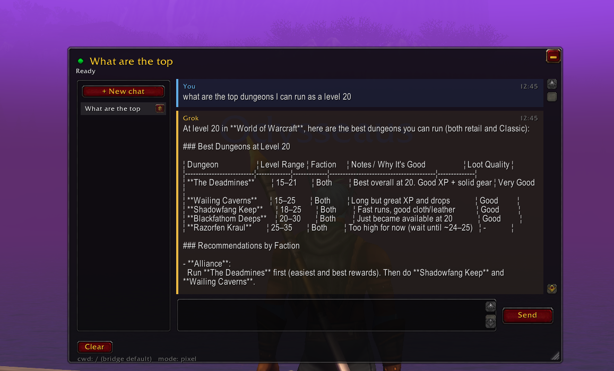
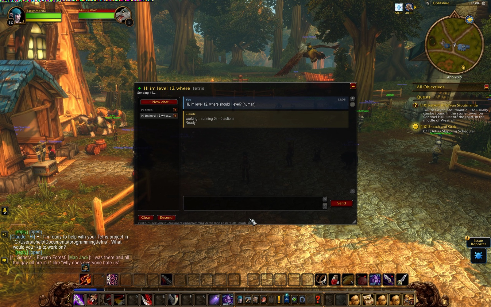
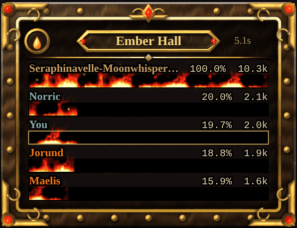
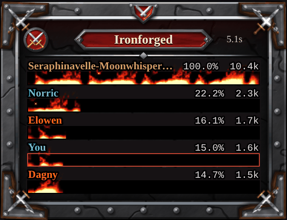
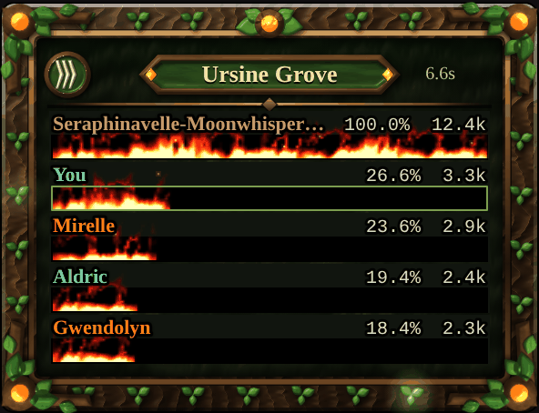
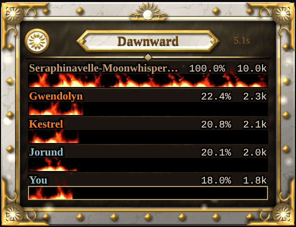
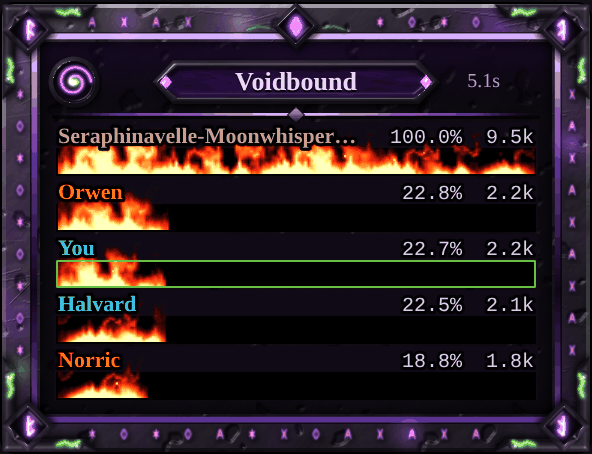
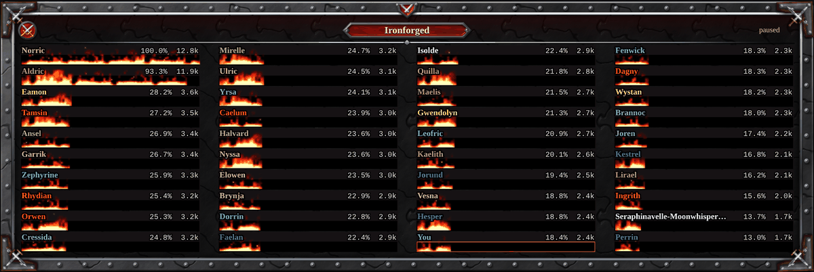

# wow-addons

World of Warcraft: Forever addons by Odysseaus, built for the classic beta client (Interface `16001`). Each addon has its own folder, README, and GitHub Releases tag.

## Index

| Addon | Folder | Status | Get it |
|-------|--------|--------|--------|
| [WoW Grok](#wow-grok) | [`wow-grok/`](wow-grok/) | Released (Mac app, Windows app, addon zip) | [Releases](https://github.com/Odysseaus/wow-addons/releases) (`wow-grok-mac-v…`, `wow-grok-win-v…`) |
| [WoW Threat](#wow-threat) | [`wow-threat/`](wow-threat/) | Released | [`wow-threat-v1.3.0`](https://github.com/Odysseaus/wow-addons/releases/tag/wow-threat-v1.3.0) |
| [QuestGrind](#questgrind) | [`quest-grind/`](quest-grind/) | 🚧 Under construction, not released | No release yet |

## Where AddOns go

For any addon you install by copying a folder, put the folder in your AddOns directory:

- **Mac:** `/Applications/World of Warcraft/_classic_beta_/Interface/AddOns/`
- **Windows:** `C:\Program Files (x86)\World of Warcraft\_classic_beta_\Interface\AddOns\`. Your drive letter or install folder may be different.

Then type `/reload` in game. If the game wasn't running, or the addon is brand new and doesn't show up, fully quit and relaunch WoW, then check that it's enabled under **AddOns** at character select.

---

## WoW Grok

Folder: [`wow-grok/`](wow-grok/) · In-game addon: [`wow-grok/addon/WoWGrok/`](wow-grok/addon/WoWGrok/) · Full README: [`wow-grok/README.md`](wow-grok/README.md)

Chat with your xAI Grok (API chat) from inside the game. Send a task, keep questing, and get pinged in game when the answer lands. Claude (Anthropic key) is an optional provider. A companion app on your Mac or Windows PC sends your message to the API with **your** key. Addons can't go online, so the app reads a strip of colored pixels the addon draws on screen and writes replies back into AddOn files the game loads.

- Open it with `/wow-grok` or `/grok` (also `/ai`, `/ask`).
- Shift-click items, spells, and quests into the input to insert links.
- Multiple chats, a status light, and reply recovery.
- The addon list shows version `0.1.22` (Author: chelinho139). It's based on the MIT [wow-claude](https://github.com/chelinho139/wow-claude), with the companion bridge rewritten in Python.
- **Not supported:** GeForce Now, Shadow, or any cloud or streaming WoW. The app must run on the same computer as a normal local WoW install.

  

<em>The WoW Grok chat window in game.</em>

  

<em>The same chat window in upstream wow-claude (this image comes from that project).</em>

### Download & install

WoW Grok installs differently from the other addons. **Don't copy the folder by hand.** Download the companion app. It finds your AddOns folder (or asks you for it), writes the `WoWGrok` addon plus its reply slots (`WoWGrok_S001`–`WoWGrok_S200`), and then keeps running as the bridge while you play. You need an API key from [console.x.ai](https://console.x.ai/) (the default), or a Claude key. Mac and Windows are separate downloads.

**Mac** ([step by step](wow-grok/docs/INSTALL-MAC.md))

1. From [Releases](https://github.com/Odysseaus/wow-addons/releases), get the newest `wow-grok-mac-v…` build: `WoWGrok.dmg` or `WoWGrok-mac-arm64.zip`. Right now [`wow-grok-mac-v0.1.31`](https://github.com/Odysseaus/wow-addons/releases/tag/wow-grok-mac-v0.1.31) is marked pre-release and [`wow-grok-mac-v0.1.30`](https://github.com/Odysseaus/wow-addons/releases/tag/wow-grok-mac-v0.1.30) is the newest full release. Both are Apple Silicon (arm64) builds.
2. Drag **WoWGrok.app** into Applications and launch it from there. The build is unsigned, so **Control-click → Open**, then **Open Anyway** in Privacy & Security if macOS asks.
3. In the setup wizard, pick Grok (xAI) or Claude, paste your key, and confirm your `Interface/AddOns` folder. Grant **Screen Recording**, and quit and reopen once if it asks. Leave the **menu bar** icon running.

**Windows** ([step by step](wow-grok/docs/INSTALL-WINDOWS.md))

1. Download `WoWGrok.exe` from the newest `wow-grok-win-v…` release. Right now that's [`wow-grok-win-v0.1.31`](https://github.com/Odysseaus/wow-addons/releases/tag/wow-grok-win-v0.1.31).
2. Run it. The build is unsigned, so if SmartScreen says "Windows protected your PC", click **More info → Run anyway**.
3. In the setup wizard, pick xAI or Claude, paste your key, and confirm your `Interface\AddOns` folder. Leave the **tray** icon **Running**.

**Then, on both:** play in **Windowed** or **Windowed (Fullscreen)** mode. Exclusive fullscreen blocks the screen read. **Fully quit and relaunch** WoW, because `/reload` doesn't pick up brand-new AddOns. At character select, enable **WoW Grok** and leave the `WoW Grok slot ###` entries on. Type `/wow-grok` or `/grok`.

There's also an addon-only zip, [`wow-grok-addon-v0.1.22`](https://github.com/Odysseaus/wow-addons/releases/tag/wow-grok-addon-v0.1.22) (`WoWGrok-0.1.22.zip`). It holds just the in-game `WoWGrok` folder: no app and no reply slots. The addon can't get replies without the companion app running, so most players should use the app above.

More: [all-platform overview](wow-grok/docs/INSTALL-USERS.md) · [how it works](wow-grok/docs/ARCHITECTURE.md) · [configuration](wow-grok/docs/CONFIGURATION.md) · [changelog](wow-grok/CHANGELOG.md)

---

## WoW Threat

Folder: [`wow-threat/`](wow-threat/) · Addon: [`wow-threat/WoWThreat/`](wow-threat/WoWThreat/)

A single, clean threat meter for Forever. It lists your group against your hostile target with the highest threat on top, using the client's `UnitDetailedThreatSituation`.

- **One bar meter:** each row shows the first name (realm stripped, long names cut off with …, class-colored text) above a black bar, with % and raw threat (12.3k) on the right. Your own row gets a theme-colored outline and stays pinned when you fall outside the shown rows.
- **The fire is the bar:** the default "Fireplace" fire is a baked, seamless flame wall whose width is your threat %. It's cropped, never stretched, and its tips rise above the bar. It has sparks, a glow and a white-hot core above 90%. A lighter "Classic" style, "Castbar fire" (layered scrolling fire, smoke and embers, new in 1.2.0) and "Off" (plain bar) are also available. All fire art is original and generated by `wow-threat/tools/`.
- **Five themes:** Ember Hall (default), Ironforged (Warrior), Ursine Grove (Druid), Dawnward (Paladin) and Voidbound (Warlock). Each has a textured frame, corners, crest, medallion and plaque, a light animation (gem glow, rocking swords plus a glint, rustling leaves, a turning sun with motes and a light sweep, pulsing runes with wisps). Every theme uses the same Ironforged fire. Auto picks by class.
- **Motion:** bars and numbers count smoothly, rows slide to their new rank, and a new #1 gets a short pop.
- **Columns:** Auto or 1–4, ranked across columns and capped at about 60% of the screen width, with up to 10 rows per column. Rows fade out when combat ends. With more than 20 rows the fire drops its glow layer and sparks stay on the top 10.
- **Edit Mode:** open Edit Mode to see a blue "WoW Threat" selection with preview rows. Drag it (snaps to 8 px), or click it for Scale, Max rows, Bar width, Columns, Theme, Fire style and Reset position. Positions are saved per Edit Mode layout. The meter can't be moved outside Edit Mode.
- **Options panel:** Esc > Options > AddOns > WoW Threat (or `/wtm options`): Max rows, Columns, Bar width, Row height, Scale, Theme, Animate frame, Show fire, Fire style, Fire intensity, Fire speed, Flame overflow, Fire sound (off by default; SFX channel, in combat only), Reduced effects, Show pop, Number format, Show only in group, Hide out of combat, Class colors, Test mode and Reset position. It stays in sync with the Edit Mode dialog.
- **Slash commands** (`/wtm` or `/wowthreat`): `options`, `test [raid20|raid40|swap|swapfast]`, `theme <auto|emberhall|ironforged|ursinegrove|dawnward|voidbound>`, `style <fireplace|classic|castbar|off>`, `fire <0-1|off|on>`, `reset`, `debug` (prints one threat-scale line per unit), `probe` (API check). Anything else prints the help.
- Settings are saved in `WoWThreatDB` (schema v3). Upgrades from 0.1.x and 1.0.0 migrate automatically.
- Version `1.3.0` (latest release [`wow-threat-v1.3.0`](https://github.com/Odysseaus/wow-addons/releases/tag/wow-threat-v1.3.0)), Interface `16001`.

### Screenshots

> **Previewer renders, not in-game.** These come from the addon previewer, set up to match 1.1.4: Fireplace fire with the Ironforged tint, black bars, mid-combat. In-game captures will replace them later.

| | |
|---|---|
|  **Ember Hall** (default) · Previewer render (not in-game) |  **Ironforged** (Warrior) · Previewer render (not in-game) |
|  **Ursine Grove** (Druid) · Previewer render (not in-game) |  **Dawnward** (Paladin) · Previewer render (not in-game) |
|  **Voidbound** (Warlock) · Previewer render (not in-game) | |

**Raid 40, 4 columns × 10 rows** (Ironforged) · Previewer render (not in-game; simulation paused so rows are settled)

### Download & install

1. Download the `WoWThreat` zip from the latest `wow-threat-v…` release on the [releases page](https://github.com/Odysseaus/wow-addons/releases). The latest is [`wow-threat-v1.3.0`](https://github.com/Odysseaus/wow-addons/releases/tag/wow-threat-v1.3.0) (`WoWThreat-1.3.0.zip`).
2. Unzip it. You'll get a `WoWThreat` folder, which includes `Textures/`.
3. Copy the `WoWThreat` folder into your AddOns directory, replacing any older copy:
   - Mac: `/Applications/World of Warcraft/_classic_beta_/Interface/AddOns/`
   - Windows: `C:\Program Files (x86)\World of Warcraft\_classic_beta_\Interface\AddOns\` (your drive or install folder may differ)
4. Type `/reload` in game, then `/wtm test` to see it, or open Edit Mode to place it.

---

## QuestGrind

> 🚧 **UNDER CONSTRUCTION, NOT RELEASED YET.** QuestGrind has no GitHub release. What's here is work in progress and may change or break.

Folder: [`quest-grind/`](quest-grind/) · Addon: [`quest-grind/QuestGrind/`](quest-grind/QuestGrind/) · Full README: [`quest-grind/README.md`](quest-grind/README.md) · [Changelog](quest-grind/CHANGELOG.md)

An in-game quest HUD for WoW Forever, meant to be prettier than alt-tabbing to a guide. It has two modes, **Full** and **Simple**, plus class color themes picked in Edit Mode. It reads your live quest log, prioritizes incomplete quests, and shows distance and a direction arrow when the game provides coordinates. It falls back to a mock route when your log is empty. Slash: `/questgrind` or `/qg`. Later phases are planned: **Ask SI** through a desktop companion (P2), hiding Blizzard objectives (P3), and art polish (P4). `main` has `0.2.13`; `0.2.14` (Compass mode removed, Less renamed Simple) is in an open pull request.

> 📷 **Screenshot needed:** the QuestGrind HUD in **Full** mode with a live quest (plus **Less** and **Compass** if possible).

### Download & install

There's nothing to download yet. QuestGrind will get its own `quest-grind-v*` release when it's ready. Until then it is for testing only: the folder to copy is `quest-grind/QuestGrind/`, taken from a [ZIP of this repo](https://github.com/Odysseaus/wow-addons/archive/refs/heads/main.zip). It goes into the AddOns directory as `QuestGrind` (see [Where AddOns go](#where-addons-go)), followed by `/reload`.
